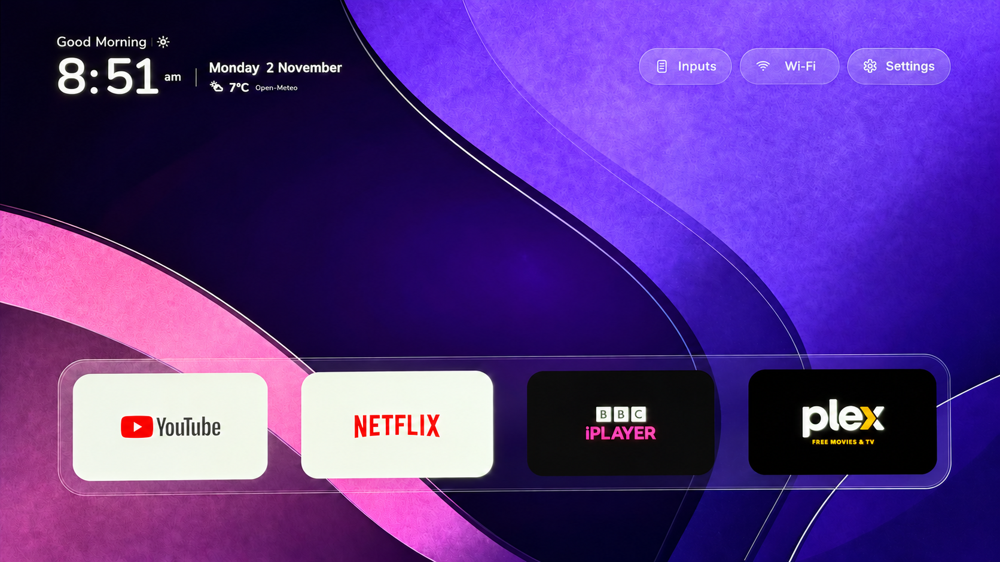
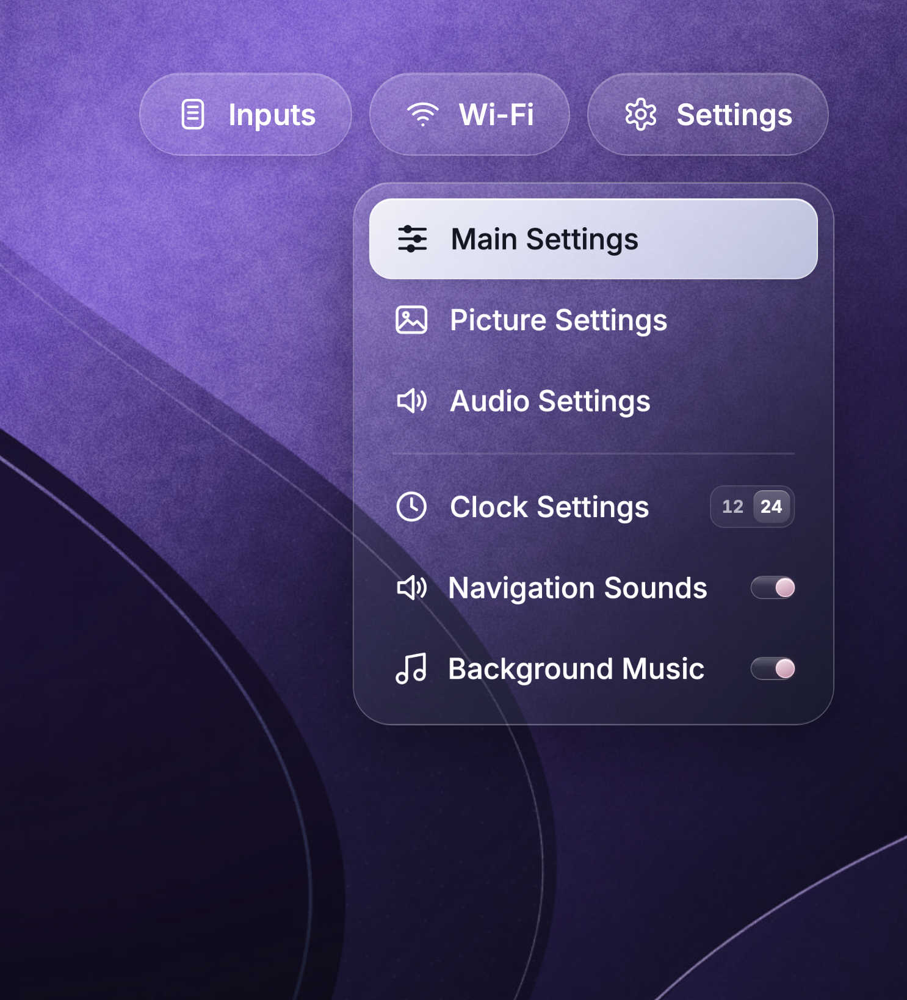
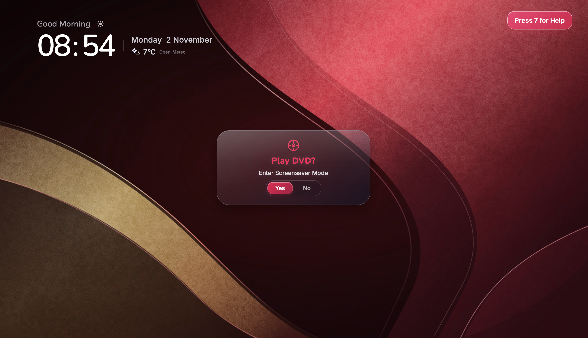
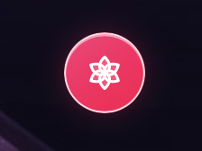

# GlassOS

<p align="center"></p>

### GlassOS (Minimal) — a glassy launcher for LG TVs

**GitHub repository:** GlassOS  
**Variant name:** GlassOS (Minimal)  
**Name shown on the TV:** GlassOS (Minimal)

GlassOS is an independent home screen designed for the big screen and the LG remote. Its visual style is clean and spacious, with soft light, layered glass surfaces and an Apple-inspired sense of clarity. GlassOS has its own layout, logo and controls; it is not an Apple product and is not affiliated with Apple or LG.

GlassOS (Minimal) is an independent, remote-friendly home screen for LG TVs running webOS. It is a separate variant of GlassOS, called **GlassOS (Minimal)** on the TV, and installs through Developer Mode; it does not replace webOS or require rooting the TV.

## Screenshots

The home-screen image below is a straightened, screenshot-style crop of GlassOS running on an LG TV. The other images show the settings panel, the DVD Bounce prompt in Zen Mode, and the Zen Mode entry button.

<p align="center"></p>

<table>
  <tr>
    <td align="center"><strong>Settings, clock and sound controls</strong><br></td>
    <td align="center"><strong>Zen Mode and DVD Bounce</strong><br></td>
  </tr>
</table>

<p align="center"><strong>Enter Zen Mode for a distraction free experience</strong><br></p>

## What GlassOS does

### A home screen built around your TV

- **A quiet, information-rich header.** See a time-of-day greeting, date, and clock in either 12-hour or 24-hour format.
- **Optional local weather.** Add coordinates in `app/config.js` to show the current temperature and conditions. Weather is off in the public starter configuration, so no location is sent until you choose to enable it.
- **A glass shelf and app grid.** Installed TV apps appear as large, remote-friendly tiles. The glass highlight follows focus, and tile backgrounds adapt to each app's icon colours.
- **A configurable dock and app order.** Choose the dock apps, rearrange tiles with the remote,.
- **Add Apps and restore.** Open the app library to bring removed apps back. Apps can be hidden from GlassOS without uninstalling them from webOS.
- **Inputs in one place.** Open HDMI inputs, Live TV, or AirPlay when those are available and enabled. HDMI names are taken from your TV, so your own input labels are used.
- **TV status and settings.** The header shows the current Wi-Fi or Ethernet status. GlassOS also provides shortcuts into webOS settings.
- **Remote and pointer support.** Navigate with the directional pad and OK button, or use the TV pointer where available.

### A clean, glassy, Apple-inspired look

The interface uses a dark, atmospheric backdrop, generous spacing, translucent panels and softly animated transitions. App cards pick up colour from their icons, helping the grid feel cohesive while keeping each app easy to recognise. The visual direction takes inspiration from Apple's clean, glass-like interface design while keeping GlassOS's own identity.

### Zen Mode

Zen Mode turns the home screen into an ambient display. Open it from the Zen button in the footer, press Back three times quickly from the home screen, or leave the TV untouched for four minutes and let it start automatically. It has its own animated wallpaper and clock, plus optional ambient music.

Zen Mode includes:

- A softly animated DVD-inspired wallpaper with the clock available on screen.
- **Night and Midnight display modes**, cycled with the 0 key. Press 0 repeatedly to move through the darker looks and return to the normal Zen display.
- **DVD Bounce**, an animated DVD-style logo on the Zen wallpaper and a mini-game. Try to land the bouncing logo on all ten screen corners.
- A small help panel and score counter while DVD Bounce is running, plus separate clock and background controls.
- Gentle transitions and audio that can be switched off in Settings.

### Remote keypad and controls

| Remote control | What it does |
| --- | --- |
| Up, Down, Left, Right | Move focus around the app grid, dock, header and menus. |
| OK / Enter | Open the focused app or menu item. In app-move mode, drop the tile in its new position. |
| Hold OK on an app tile | Pick the tile up so you can move it with the directional pad. |
| Back / Return | Close an open panel or cancel an app move. In Zen Mode, a non-zero key returns to the home screen unless it is being used by DVD Bounce. |
| Back / Return three times quickly | Open Zen Mode from the home screen. |
| Hold a number key while GlassOS is open | Assign GlassOS to that webOS Quick Access number for one-press launching. |

In Zen Mode, number keys have these functions:

| Key | Zen Mode action |
| --- | --- |
| 0 | Cycle between the normal, Night and Midnight background looks. |
| 1 or 2 | Change the bouncing character while DVD Bounce is active. |
| 5 | Show or hide the clock. |
| 6 | Show or hide the score counter during DVD Bounce. |
| 7 | Show or hide DVD Bounce instructions while the game is active. |
| 8 | Start or stop DVD Bounce. |

The DVD Bounce challenge is to hit ten screen corners. Outside Zen Mode, pressing 0 six times quickly changes the main screen's glass hue.

### Sounds and music

GlassOS includes subtle navigation, selection, back and Zen-mode sounds, plus a looping ambient music track. Turn **Navigation Sounds** and **Background Music** on or off from the Settings menu. Your choices are remembered on the TV. The music can be disabled without affecting app navigation.

### Personalise it

Edit `app/config.js` to set:

- Which apps appear in the dock.
- Which apps are hidden from the main grid.
- The number of app columns.
- Whether Live TV or AirPlay appears in Inputs.
- An optional weather location.

The starter `app/apps.js` contains no TV-specific data. The installer reads the installed apps and input names from your TV and generates this file, along with the app icons it needs. Check the generated files before sharing or committing your working copy. The synced icons in `app/icons/` come from the connected TV and are excluded from the public source copy; the installer regenerates them for each TV. The high-resolution logo master is `assets/glassos-icon-final.png`; each install regenerates the required 80×80 and 130×130 app icons from it, and GlassOS's own app tile uses the high-resolution master.

### Minimal footer

This minimal variant removes the creator logo and © line from the footer and places the Zen Mode icon neatly beneath the divider. The signature artwork remains available for the optional DVD Bounce logo mode.

## Install on an LG webOS TV

GlassOS is a non-invasive launcher app: it does not require rooting the TV, hacking webOS, or replacing system software. Installation uses the TV’s built-in Developer Mode with Key Server enabled, plus the webOS developer tools to install the app.

### Requirements

- An LG webOS TV with the Developer Mode app installed.
- Developer Mode enabled, with its Key Server turned on.
- Node.js/npm if you want the installer to fetch the webOS CLI automatically; or the webOS CLI already available in your PATH.
- Python 3 and the `websockets` package.
- The TV and computer on the same local network for app and input synchronisation.

### Pair the TV

Open the Developer Mode app on the TV and turn on Developer Mode and Key Server. Configure the webOS CLI with a device alias named `lgtv`. Sample setup commands are in the comments at the top of `install.sh`. On first connection, accept the pairing prompt on the TV.

### Install and launch

From this project folder:

```sh
python3 -m pip install websockets
TV_HOST=192.0.2.10 ./install.sh
```

Replace `192.0.2.10` with the IP address shown in your TV's network settings. The script synchronises the TV's app and input list, packages GlassOS, installs it, and launches it. If webOS CLI commands are not already installed, the script uses `npx` to run LG's `@webos-tools/cli`.

The TV pairing key is saved in `.lgtv-key.json`. Keep it private and do not commit it. The installer also writes TV-specific app names and icons into the project, so review those changes before sharing your source.

To package without installing, run `ares-package app -o build` after setting up the webOS CLI. A package created from an empty starter app list will not have your TV's app tiles; sync your own TV first if you want a package tailored to it.

## Privacy and network use

- GlassOS reads app names, app icons and input labels from the TV on your local network during setup.
- The TV pairing key is stored locally in `.lgtv-key.json`; it is not part of the public starter files.
- Weather is disabled by default. If you enable it, the configured coordinates and time zone are sent to Open-Meteo to request current conditions.
- GlassOS stores interface preferences, removed-app choices and cached weather on the TV in local browser storage.

## Project files

- `app/` — webOS app, visual assets, configuration and app-list starter data.
- `assets/` — source artwork, the GlassOS icon master and README screenshots.
- `install.sh` — sync, package, install and launch helper.
- `sync-apps.py` and `lgtv.py` — TV app/input synchronisation and local connection helpers.
- `LICENSE` — MIT license.

## Beta status and credits

GlassOS is beta software. It has been checked on one LG OLED48C26LB running firmware 23.25.55 (the webOS CLI reports SDK version 9.2.2). Broader model and firmware compatibility have not yet been documented. Back up anything important and use Developer Mode at your own discretion.

The source code is under the MIT license. Bundled fonts include their own license notices under `app/fonts/`. The bundled artwork and music are included with permission from their rights holders; that permission does not automatically grant reuse rights to others. GlassOS is an independent community project and is not endorsed by Apple, LG, or any app provider.
